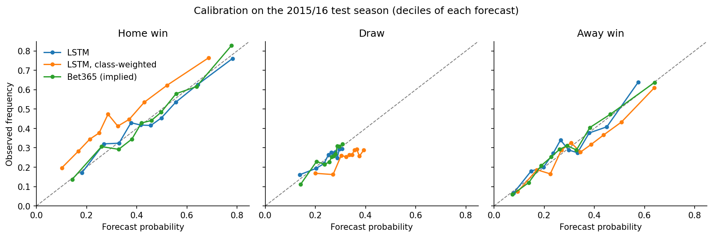
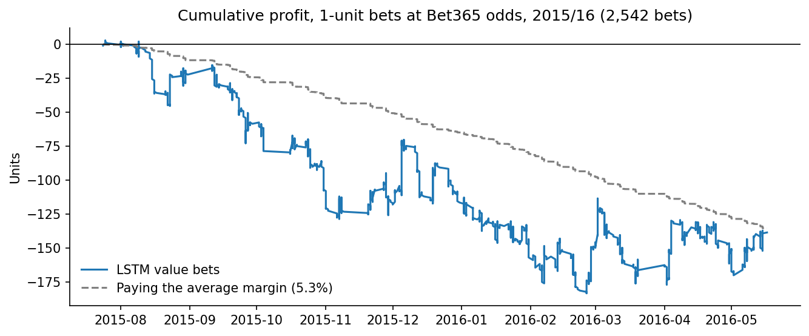

# Football match outcome probabilities: an LSTM against the betting market

Pre-match probabilities for **home win, draw and away win** in 11 European leagues,
learned from each team's recent results with an LSTM and benchmarked against the
probabilities implied by bookmaker odds. Includes a value-betting backtest and a
FastAPI service.

**Key findings (2015/16 test season, 2,843 matches):**

- The LSTM reaches a log-loss of **1.004**, significantly better than a feed-forward
  baseline (1.029) and base rates (1.070).
- It closes **71% of the gap** between base rates and the market, but Bet365's implied
  probabilities remain better (**0.977**).
- Betting on the model's "value" at Bet365 odds returns **−5.5%** (95% CI −12.8% to
  +1.7%), roughly the bookmaker's margin: there is no exploitable edge.

## Results

| Model (test season 2015/16) | Log-loss ↓ | Brier ↓ | Accuracy | Macro-F1 |
|---|---:|---:|---:|---:|
| Base rates | 1.070 | 0.647 | 44.6% | 0.21 |
| Logistic regression | 1.032 | 0.620 | 48.5% | 0.34 |
| MLP on window averages | 1.029 | 0.618 | 48.7% | 0.34 |
| LSTM, class-weighted | 1.036 | 0.620 | 46.3% | **0.44** |
| **LSTM** | **1.004** | **0.600** | 50.7% | 0.37 |
| Bet365, implied | 0.977 | 0.582 | 52.2% | 0.38 |
| Pinnacle, implied | 0.978 | 0.583 | 52.2% | 0.38 |

Log-loss and Brier are proper scoring rules: they reward probabilities that are sharp
*and* calibrated, which is what matters for pricing. Class weights maximize macro-F1 but
distort the probabilities: they move mass from home wins to draws.





## Approach

**Data.** [European Soccer Database](https://www.kaggle.com/datasets/hugomathien/soccer):
25,979 league matches from 11 countries (2008/09 – 2015/16), with pre-match odds from
several bookmakers. It is downloaded with `kagglehub`; no data is stored in this repo.

**Market benchmark.** Implied probabilities are the inverse odds normalized to sum to
one, which removes the bookmaker's margin (6.2% on average for Bet365, 2.4% for Pinnacle).

**Features without look-ahead.** Each team is represented by its last 5 matches before
kick-off: goals for, goals against, goal difference, points and home/away. Matches are
processed chronologically and the history is updated only after the sample is built,
so a result never leaks into its own prediction (tested in `tests/`).

**Chronological validation.** Train on 2008/09 – 2013/14, validate on 2014/15 (early
stopping, window length, betting threshold) and test once on 2015/16. Scaling is fitted
on training data only, and training is seeded, so the results are reproducible.

**Model.** A shared LSTM encodes the recent form of both teams; team and league
embeddings capture persistent strength; a dense head outputs the three probabilities.
18k parameters, trained on log-loss.

**Backtest.** In each match, bet 1 unit at Bet365 odds on the outcome with the highest
expected value $p \cdot o - 1$, if it exceeds a minimum edge chosen on validation.
The ROI interval is a bootstrap over bets.

## API

The trained model is served with FastAPI. It takes each team's last 5 matches and
returns the probabilities and the fair odds (1/p):

```bash
uvicorn api.app:app
curl -X POST http://127.0.0.1:8000/predict \
     -H "Content-Type: application/json" -d @api/example_request.json
```

```json
{"match": "Sint-Truidense VV vs Club Brugge KV",
 "probabilities": {"home": 0.2013, "draw": 0.2688, "away": 0.53},
 "fair_odds": {"home": 4.97, "draw": 3.72, "away": 1.89}}
```

Interactive documentation is available at `http://127.0.0.1:8000/docs`.

## Reproduce

```bash
pip install -r requirements.txt
jupyter nbconvert --to notebook --execute --inplace notebooks/football_outcome_probabilities.ipynb
pytest
```

The notebook trains every model (under a minute on a laptop CPU), writes the figures
and exports the model to `artifacts/`.

```
├── src/football/       data loading, features, models, metrics, backtest
├── notebooks/          end-to-end analysis
├── api/                FastAPI service and an example request
├── artifacts/          trained model and preprocessing
├── reports/figures/    figures used in this README
└── tests/              look-ahead, implied probabilities, backtest accounting
```

## Limitations and next steps

- One test season; a rolling evaluation over several seasons would give tighter estimates.
- The dataset does not say whether the odds are opening or closing prices.
- Promoted teams without training history get untrained embeddings.
- Next: feed market probabilities into the model to test whether it adds information
  beyond the market, and add features such as Elo ratings or expected goals.

## Background

This started as my final project for the Deep Learning module of Tokio School's Python,
AI and Machine Learning program. This version refactors the code into a tested package,
replaces accuracy-based evaluation with proper scoring rules, makes training reproducible
and adds the market benchmark and the backtest.

---

Daniel Garcia Sanchez · [LinkedIn](https://linkedin.com/in/daniel-gsanchez)
